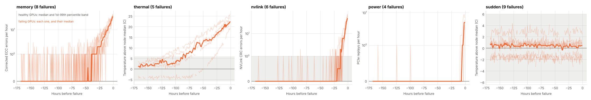

# GPU Fleet Failure Prediction

Predict failing GPUs and training-job stragglers from fleet telemetry (temperatures, power,
clocks, ECC and NVLink errors, Xid codes, step times).

The goal is a system that warns 12 to 72 hours before a GPU fails, keeps false alarms
under 5 per 1,000 GPU-days, and points out GPUs that slow down their training jobs, with
the likely cause. See the [8-week plan](docs/plan.md).

## Status

| Week | Focus | Status |
| --- | --- | --- |
| 1 | Package, telemetry schema, fleet simulator | Done ([notes](docs/weeks/week-01.md)) |
| 2 | Data realism, real-data loader, exploration | Done ([notes](docs/weeks/week-02.md)) |
| 3 | Labels and features | Next |
| 4 | Baseline models and evaluation | |
| 5 | Straggler detection | |
| 6 | Sequence models and calibration | |
| 7 | Serving and dashboard | |
| 8 | Explanations, model card, write-up | |

## Quick start

```bash
python -m venv .venv && source .venv/bin/activate
pip install -e ".[dev]"

gpufleet simulate --out data/sim          # 256 GPUs, 30 days, ~6 seconds
gpufleet summarize data/sim               # validate, print counts and data quality
gpufleet plots data/sim                   # exploration figures into docs/figures
pytest -q
```

Options: `--nodes`, `--days`, `--step-minutes`, `--seed`, `--failure-rate`, or
`--config my.json` with any field of `gpufleet.config.SimConfig`.

To explore interactively, install `pip install -e ".[notebook]"` and open
[notebooks/01_explore.ipynb](notebooks/01_explore.ipynb).

## Real fleet data

`gpufleet ingest` loads NVIDIA DCGM exporter output, from raw scrapes or a Prometheus
range query, into the same schema. See [docs/real-data.md](docs/real-data.md).

```bash
gpufleet ingest --prometheus-json dump.json --out data/real
gpufleet summarize data/real --step 5min
```

## Simulated data

There is no public dataset of per-GPU health telemetry with labelled failures, so the
project starts with a simulator. It writes:

| File | Contents |
| --- | --- |
| `telemetry.parquet` | One row per GPU per scrape, DCGM-style fields ([schema](docs/telemetry-schema.md)) |
| `failures.parquet` | Ground truth: failure mode, onset time, failure time, repair time |
| `stragglers.parquet` | Ground truth: slow-GPU intervals and their cause |
| `inventory.parquet` | Every physical GPU and when it was installed or removed |
| `maintenance.parquet` | Ground truth: reboots, driver upgrades, drains and GPU swaps per node |
| `config.json` | Settings used, for reproducing the run |

The simulator injects five failure modes (memory, thermal, NVLink, power, and sudden
failures with no warning), three kinds of stragglers, and benign look-alikes such as
healthy GPUs with noisy ECC counters, so that no single metric gives the answer away.
It also reproduces messy collection: maintenance that resets counters, exporter outages,
lost scrapes and node clock skew. Details are in the [week 1](docs/weeks/week-01.md) and
[week 2](docs/weeks/week-02.md) notes.



## Layout

```
src/gpufleet/
  config.py      simulator settings and failure-mode definitions
  schema.py      telemetry schema and validator
  simulator.py   synthetic fleet generator
  clean.py       clock alignment, counter resets, gaps, data-quality report
  ingest.py      DCGM exporter / Prometheus loader
  explore.py     exploration signals and figures
  cli.py         command line
notebooks/       exploration notebook
tests/           pytest suite
docs/            plan, schema, weekly notes
```
