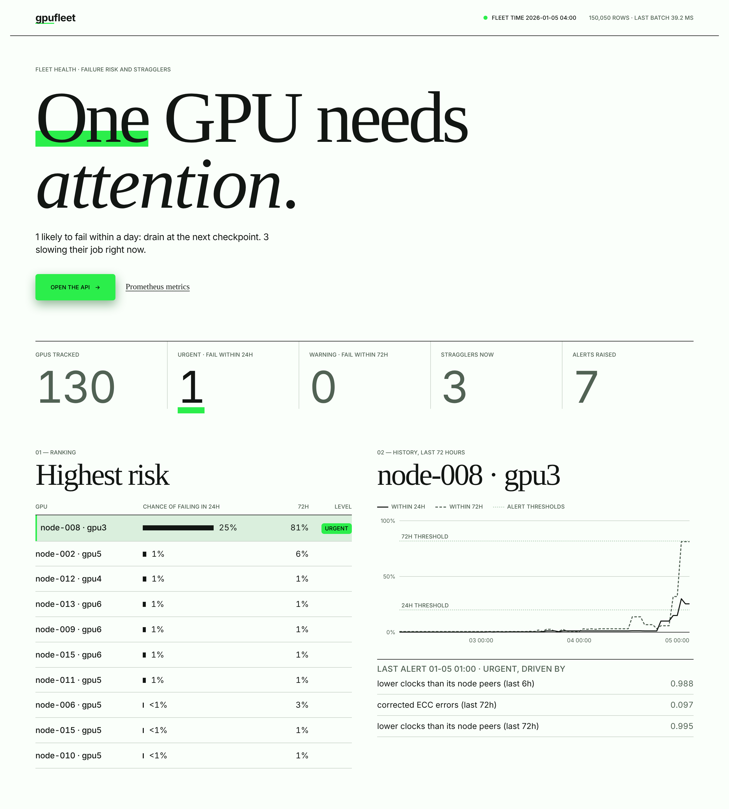

# GPU Fleet Failure Prediction

Predict failing GPUs and training-job stragglers from fleet telemetry (temperatures, power,
clocks, ECC and NVLink errors, Xid codes, step times).

The goal is a system that warns 12 to 72 hours before a GPU fails, keeps false alarms
under 5 per 1,000 GPU-days, and points out GPUs that slow down their training jobs, with
the likely cause. See the [8-week plan](docs/plan.md).

## Results

On three simulated 512-GPU fleets (60 days each, scored on the last 14), the shipped
two-tier model:

| Target | Goal | Result | Met? |
| --- | --- | --- | --- |
| Predictable failures caught | at least 70% | **93%** (68 of 73) | yes |
| False alerts | under 5 per 1,000 GPU-days | **1.3** | yes |
| Median warning before failure | at least 12 h | **27 h** | yes |
| PR-AUC vs a rules baseline | at least 2x | **2.0x** | yes |
| Straggler precision / recall | 0.9 / 0.9 | **0.95 / 1.00** | yes |
| Scoring latency, 512 GPUs | under 1 s per scrape | **66 ms** median, 0.45 s worst | yes |

For comparison, fixed operator rules catch about as many failures (92%) but raise **55**
false alerts per 1,000 GPU-days. For a 512-GPU fleet, that's about 28 false pages a day
against less than one. Sudden failures with no warning signs (about 15%) can't be predicted
and are reported separately. **All of this is simulated data.** See the
[model card](docs/model-card.md) for what that does and doesn't tell you.



How it works:

- **Two alert tiers.** A 72h model raises a *warning* (schedule a health check) and a 24h
  model an *urgent* alert (drain at the next checkpoint). Both are LightGBM, calibrated to
  real probabilities, with thresholds picked by an explicit cost of false alerts versus
  late or missed failures ([week 6](docs/weeks/week-06.md)).
- **Every alert says why**, for example "NVLink CRC errors accelerating". On fleets the
  model never saw, one of the top three reasons names the failing part in 99.7% of true
  alerts ([week 8](docs/weeks/week-08.md)).
- **Stragglers** are GPUs slowing their training job. They are found by comparing step
  times with node peers, with a likely cause: overheating, low clocks, or not the GPU at
  all ([week 5](docs/weeks/week-05.md)).
- **Streaming service** with the same feature code as training, a FastAPI service, a live
  dashboard, and Prometheus metrics and alert rules ([week 7](docs/weeks/week-07.md)).

[Demo video](docs/demo/dashboard.mp4) (90 s): the shipped model scores a fleet it has never
seen, streamed in live.

## Run the demo

```bash
docker compose up --build
```

Open http://localhost:8000 for the dashboard and http://localhost:9090/alerts for
Prometheus. The API loads the pretrained bundle in `models/demo-bundle`, and a replayer
streams a freshly simulated 128-GPU week into it at about 15 seconds per simulated day.
`TRAIN=1 docker compose up --build` trains a new bundle first (about 10 minutes).

Without Docker:

```bash
pip install -e ".[serve]"
gpufleet serve --bundle models/demo-bundle &                     # http://127.0.0.1:8000
gpufleet simulate --out data/live --nodes 16 --days 7 --seed 42 --failure-rate 0.01
gpufleet replay data/live --rate 20
```

API: `POST /v1/telemetry` (JSON rows) or `POST /v1/scrape` (raw DCGM exporter text), then
`GET /v1/risk`, `/v1/alerts`, `/v1/stragglers`, `/v1/gpu/{uuid}` and `/metrics`. Interactive
docs are at `/docs`.

## Status

All eight weeks of the [plan](docs/plan.md) are done.

| Week | Focus | Notes |
| --- | --- | --- |
| 1 | Package, telemetry schema, fleet simulator | [week 1](docs/weeks/week-01.md) |
| 2 | Data realism, real-data loader, exploration | [week 2](docs/weeks/week-02.md) |
| 3 | Labels and features | [week 3](docs/weeks/week-03.md) |
| 4 | Baseline models and evaluation | [week 4](docs/weeks/week-04.md) |
| 5 | Straggler detection | [week 5](docs/weeks/week-05.md) |
| 6 | Calibration, cost-based thresholds, sequence model | [week 6](docs/weeks/week-06.md) |
| 7 | Streaming scorer, API, dashboard, Docker demo | [week 7](docs/weeks/week-07.md) |
| 8 | Explanations, ablations, model card | [week 8](docs/weeks/week-08.md), [model card](docs/model-card.md) |

## Quick start

```bash
python -m venv .venv && source .venv/bin/activate
pip install -e ".[dev]"

gpufleet simulate --out data/sim          # 256 GPUs, 30 days, ~6 seconds
gpufleet summarize data/sim               # validate, print counts and data quality
gpufleet plots data/sim                   # exploration figures into docs/figures
gpufleet features data/sim                # hourly labelled feature table
gpufleet baselines data/sim/features.parquet --out reports/my-run   # week 4 models
gpufleet stragglers data/sim                                           # week 5 detector
pytest -q

# Weeks 6-8 need more history: rolling validation uses the 20 days before the test period.
gpufleet simulate --out data/sim60 --days 60
gpufleet features data/sim60
gpufleet policies data/sim60/features.parquet --out reports/my-policies    # week 6
gpufleet ablations data/sim60/features.parquet                             # week 8
gpufleet train-bundle data/sim60/features.parquet --out models/bundle      # deployable model
```

Options: `--nodes`, `--days`, `--step-minutes`, `--seed`, `--failure-rate`, or
`--config my.json` with any field of `gpufleet.config.SimConfig`.

To explore interactively, install `pip install -e ".[notebook]"` and open
[notebooks/01_explore.ipynb](notebooks/01_explore.ipynb).

## Real fleet data

`gpufleet ingest` loads NVIDIA DCGM exporter output, from raw scrapes or a Prometheus
range query, into the same schema. See [docs/real-data.md](docs/real-data.md).

```bash
gpufleet ingest --prometheus-json dump.json --out data/real
gpufleet summarize data/real --step 5min
```

## Real-data check (NCSA Delta)

Do earlier Xid errors predict critical ones on a real fleet? `gpufleet delta` downloads the
public NCSA Delta A100 / H100 Xid logs (Cui et al., SC'25, Zenodo 15851780) and tests it.
On this release, earlier Xids do **not** predict hard failures such as a GPU falling off the
bus (out-of-sample ROC-AUC 0.55, not significant). They do predict GSP firmware errors
(0.74), but mostly because both track slow changes in the fleet rather than as a short-term
warning. The release has no node, GPU or time of day, so the per-GPU, hours-ahead question
stays open. Details: [docs/delta-real-data.md](docs/delta-real-data.md).

```bash
gpufleet delta --out reports/delta
```

## Simulated data

There is no public dataset of per-GPU health telemetry with labelled failures, so the
project starts with a simulator. It writes:

| File | Contents |
| --- | --- |
| `telemetry.parquet` | One row per GPU per scrape, DCGM-style fields ([schema](docs/telemetry-schema.md)) |
| `failures.parquet` | Ground truth: failure mode, onset time, failure time, repair time |
| `stragglers.parquet` | Ground truth: slow-GPU intervals and their cause |
| `inventory.parquet` | Every physical GPU and when it was installed or removed |
| `maintenance.parquet` | Ground truth: reboots, driver upgrades, drains and GPU swaps per node |
| `config.json` | Settings used, for reproducing the run |

The simulator injects five failure modes (memory, thermal, NVLink, power, and sudden
failures with no warning), three kinds of stragglers, and benign look-alikes such as
healthy GPUs with noisy ECC counters, so that no single metric gives the answer away.
It also reproduces messy collection: maintenance that resets counters, exporter outages,
lost scrapes and node clock skew. Details are in the [week 1](docs/weeks/week-01.md) and
[week 2](docs/weeks/week-02.md) notes.


## Layout

```
src/gpufleet/
  config.py      simulator settings and failure-mode definitions
  schema.py      telemetry schema and validator
  simulator.py   synthetic fleet generator
  clean.py       clock alignment, counter resets, gaps, data-quality report
  ingest.py      DCGM exporter / Prometheus loader
  explore.py     exploration signals and figures
  features.py    hourly feature table (no look-ahead), shared by batch and streaming
  labels.py      24h / 72h labels, censoring, time split with embargo
  models.py      rules baseline, logistic regression, LightGBM
  seqmodel.py    sequence model (MLP over 48 h of raw hourly signals)
  evaluate.py    alert-level metrics: recall, false alerts, lead time
  policy.py      rolling out-of-fold scores, calibration, cost, two-tier thresholds
  experiment.py  train / validate / test protocols, ablations
  stragglers.py  straggler detection and cause attribution
  bundle.py      deployable model bundle: scoring, alert levels, explanations
  stream.py      streaming scorer
  api.py         FastAPI service; static/dashboard.html is the dashboard
  client.py      replay client (standard library only)
  delta.py       real-data check on the public NCSA Delta Xid logs
  cli.py         command line
models/demo-bundle/  pretrained bundle used by the demo
deploy/prometheus/   Prometheus config and alert rules
notebooks/       exploration notebook
scripts/         benchmark and figure scripts
reports/         saved results (baselines, week 6 policies, stragglers, ablations)
tests/           pytest suite
docs/            plan, schema, weekly notes, model card, demo video
```
