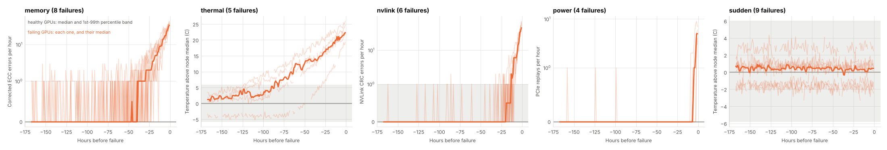
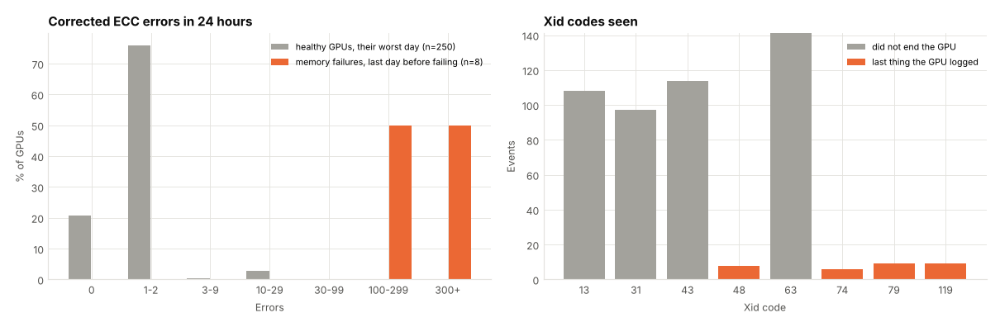
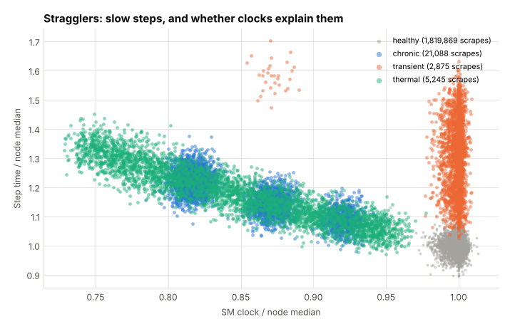
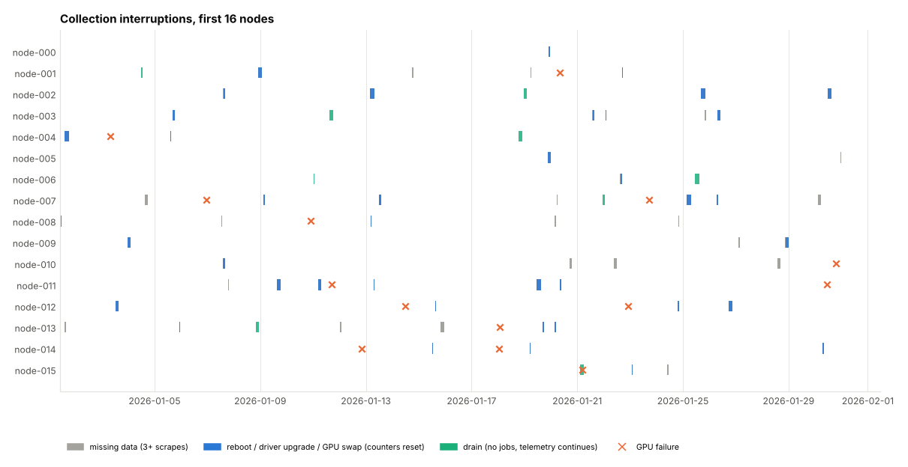

# Week 2: data realism and exploration

Exit check from the plan: each failure mode is visibly different from healthy GPUs, and
real exports load into the same schema. Both are met; details below.

## What shipped

- **Messier simulated data**, so later stages are built against what real collection looks like:
  - Node maintenance: reboots, driver upgrades and drains (about one per node every two
    weeks), plus a one-hour node outage whenever a failed GPU is swapped. Reboots, upgrades
    and swaps take the node offline and reset its DCGM counters. Drains keep telemetry
    flowing but stop jobs. Ground truth goes to `maintenance.parquet`.
  - Exporter outages (15 minutes to 3 hours, node keeps running) on top of single lost scrapes.
  - Node clock skew (about 20 seconds) and per-scrape jitter, so timestamps no longer sit
    exactly on the 5-minute grid.
- **`gpufleet.clean`**: `align_timestamps` (snap scrapes to the grid), `counter_increments`
  (per-scrape counts that survive resets), `find_gaps`, and `quality_report`.
  `gpufleet summarize` and `simulate` now print the quality report.
- **Real-data loader** (`gpufleet ingest`, `gpufleet.ingest`): reads DCGM exporter scrape
  files or Prometheus range-query JSON and writes the standard `telemetry.parquet`.
  Handles field aliases across DCGM versions, throttle-reason bitmasks, row remapping vs.
  page retirement, and DCGM's "last Xid" gauge. How to use it: [real-data.md](../real-data.md).
- **Exploration notebook** ([notebooks/01_explore.ipynb](../../notebooks/01_explore.ipynb))
  and `gpufleet plots`, which saves the figures below.
- Schema: `mem_util` and `temp_mem_c` may now be empty (not every GPU reports them), and
  counters may drop after a gap longer than 10 minutes.
- Tests: 20 to 38.

## What the data shows

Run: 256 GPUs, 30 days, failure rate raised to 0.5% per GPU per day to get 32 failures.
Data quality: 99.0% of expected scrapes present, 566 gaps over an hour, 498 counter
resets, worst node clock off by 40 seconds.

Every predictable mode leaves the healthy band before failing. How early, using the
99.9th percentile of healthy GPU-hours as the threshold and two hours above it to count:

| Mode | Failures | Warned | Median warning | Shortest warning | Signal |
| --- | --- | --- | --- | --- | --- |
| thermal | 5 | 5 | 67 h | 22 h | temperature vs node median |
| memory | 8 | 8 | 22.5 h | 12 h | corrected ECC errors per hour |
| nvlink | 6 | 6 | 10 h | 8 h | NVLink CRC errors per hour |
| power | 4 | 3 | 5 h | 2 h | PCIe replays per hour |
| sudden | 9 | 0 | none | none | none, by design |

This picks the right signal using the known failure mode, so it is a ceiling for
single-signal rules, not a model result. It does set expectations: NVLink and power
failures give hours, not days, so the 24-hour horizon will catch them late, and lead time
has to be reported per mode.

Single signals are not enough. About 3% of healthy GPUs log 10 to 29 corrected ECC errors
on their worst day. Xids 13, 31 and 43 are frequent and harmless, and Xid 63 (row remap)
happens on healthy GPUs too. The fatal codes (48, 74, 79, 119) appear at the moment of
failure, so they are labels, never features.

Transient stragglers are slow while their clocks look normal, so step time is the only
way to see them. Chronic and thermal stragglers both run at lower clocks; temperature and
history are needed to tell them apart.

## Decisions for week 3

- Features use `counter_increments` and aligned timestamps only. Raw totals never reach a model.
- Rolling windows record how many scrapes they actually saw, so a gap is not read as "no errors".
- Main signals: counter rates over 1, 6 and 24 hours and their acceleration, temperature /
  clock / power relative to node peers, 24 and 72 hour temperature trends, and Xid 63 bursts.
- Labels: fails within 24 h (and 72 h) after the row, using only rows strictly before the
  failure row. GPUs still degrading when the data ends are censored, not negatives.

## Not done

- No real fleet data has been loaded yet; the loader is tested on a realistic exporter
  sample and on simulated data round-tripped through both formats. If you can share a
  day of dcgm-exporter data, it is a one-command check.
