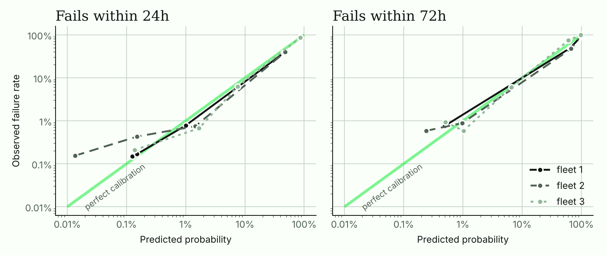
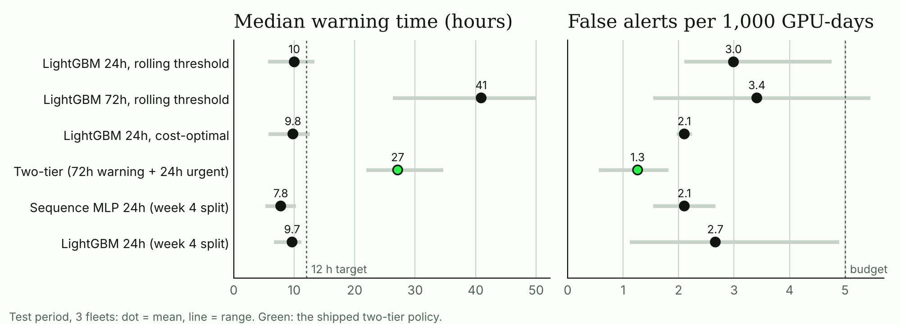

# Week 6: calibration, cost-based thresholds and a sequence model

Exit check from the plan: a calibrated model with a justified alert threshold. Met. The
week 4 gap is closed too. Two alert tiers, a 72h warning and a 24h urgent alert, now give
a median of **27 hours** of warning (the target is 12). False alerts are **1.3 per 1,000
GPU-days**, half of week 4, and recall of predictable failures is unchanged at 93%.

| Target | Goal | Week 4 (LightGBM 24h) | Week 6 (two-tier) | Met? |
| --- | --- | --- | --- | --- |
| Predictable failures caught | at least 70% | 92% | 93% (68 / 73) | yes |
| False alerts / 1k GPU-days | under 5 | 2.7 | 1.3 (0.6-1.8) | yes |
| Median warning time | at least 12 h | 10 h | 27 h (22-35) | yes |
| PR-AUC vs rules | at least 2x | 2.2x | 2.0x (24h model, rolling folds) | yes |

Mean of three 512-GPU, 60-day fleets (range in brackets), on the last 14 days of each.

```bash
gpufleet policies data/bench-seed1/features.parquet --out reports/week6/seed1   # ~10 min
python scripts/week6_figures.py
```

## What changed

**1. Thresholds from rolling out-of-fold scores, not one validation window.** Week 4 set
each threshold on a single 10-day validation window with 15 to 28 failures. That's why
the 72h model's recall swung from 38% to 92% between fleets. Now the 20 days before the
test period are cut into 4 folds of 5 days. Each fold is scored by a model trained only on
data that ends 72 hours before it starts. Stitched together, the folds hold 38 to 48
failures per fleet, about twice as many (`src/gpufleet/policy.py`, `oof_scores`).

**2. Calibration.** Isotonic regression maps those out-of-fold scores to probabilities.
On the test period, the 24h model's expected calibration error is 0.07 to 0.21
percentage points, against a base rate of 0.43% of GPU-hours. Its Brier score is 0.0026.
When it says 40%, about 40% of those GPU-hours really are within 24 hours of a failure.



**3. Thresholds picked by cost.** A threshold is a trade-off, so it is now chosen by an
explicit cost, in units of one false alert (a node drain and a health check):

| Outcome | Cost | Why |
| --- | --- | --- |
| False alert | 1 | drain, health check, put back |
| Missed failure | 20 | job crashes, work since the last checkpoint is lost, emergency swap |
| Caught failure | 2 + up to 8 | a planned swap, plus a penalty that shrinks to 0 with 12 h or more of warning (enough to move the job at a checkpoint) |

The threshold with the lowest total cost on the out-of-fold scores wins, as long as it
stays within the 5 per 1,000 GPU-days budget. The costs are in `CostModel`. Change them to
match your fleet.

**4. Two tiers.** The 72h model raises a **warning** (schedule a health check) and the 24h
model an **urgent** alert (drain at the next checkpoint). Both thresholds are picked
together by the same cost. Calibrated scores are step functions, so the search tries every
distinct score level in the top 5%. When pairs cost almost the same (within 2%), it takes
the one with the most warning time.

## Results (test period, mean and range over 3 fleets)

| Policy | PR-AUC | Predictable caught | False alerts / 1k | Median lead (h) | Precision | Cost / 1k GPU-days |
| --- | --- | --- | --- | --- | --- | --- |
| LightGBM 24h, rolling-validation threshold | 0.49 | 93% (92-96) | 3.0 (2.1-4.8) | 10 (6-13) | 53% | 36.8 |
| LightGBM 72h, rolling-validation threshold | 0.45 | 88% (83-92) | 3.4 (1.5-5.5) | 41 (26-50) | 67% | 36.2 |
| LightGBM 24h, cost-optimal threshold | 0.49 | 93% (92-96) | 2.1 (2.0-2.2) | 10 (6-13) | 60% | 36.0 |
| **Two-tier (72h warning + 24h urgent)** | 0.46 | **93% (92-96)** | **1.3 (0.6-1.8)** | **27 (22-35)** | **83%** | **31.9** |
| Sequence MLP 24h (week 4 split) | 0.40 | 96% (92-100) | 2.1 (1.5-2.7) | 8 (5-10) | 61% | 36.5 |
| LightGBM 24h (week 4 split) | 0.52 | 92% (88-96) | 2.7 (1.1-4.9) | 10 (7-11) | 58% | 37.6 |

The 72h rows and the two-tier row count an alert as true if the GPU fails within 72 hours.
The 24h rows use 24 hours. Per-fleet tables are in `reports/week6/seed*/`.



What it shows:

- **Two tiers give the most warning at the lowest cost.** The 72h model alone warns even
  earlier (41 h), but with 2.6 times the false alerts and lower recall. Pairing it with
  the 24h model, and letting the cost pick both thresholds, keeps the early warnings and
  drops the noisy ones.
- **The cost-optimal threshold mostly cuts false alerts.** For the 24h model it gives the
  same recall as the budget threshold, with 30% fewer false alerts.
- **Precision is now 83%.** About five of every six pages point at a GPU that really fails
  within three days.
- **The operating point is steadier.** False alerts range from 0.6 to 1.8 between fleets,
  against 1.1 to 4.9 in week 4.

## Sequence model

The plan called for a GRU or temporal CNN. PyTorch couldn't be installed where this was
built, so the sequence model is a multilayer perceptron (scikit-learn, 128 and 32 units).
It sees the last 48 hours of nine raw hourly signals: four error rates, temperature, clock
and step time against peers, thermal throttling, and coverage (`src/gpufleet/seqmodel.py`).
It learns its own patterns instead of using the hand-made window features.

On the week 4 split it catches slightly more predictable failures (96% vs 92%), but its
PR-AUC is lower (0.40 vs 0.52), and it warns later (8 h vs 10 h). The hand-made features
already encode what the simulator's failures look like. A learned model has more to offer
on real data, where nobody wrote the failure patterns by hand.

No separate survival model was built. The 24h and 72h calibrated probabilities are two
points on each GPU's time-to-failure curve, and they cover what the alerts need.

## Caveats

- **The 2% tie rule is a judgement call.** Without it, the shipped bundle (trained on all
  of fleet 1) picked a 72h threshold of 0.99, so warnings almost never fired, for a cost
  saving under 1%. The rule only changes the pick between near-equal options.
- **Sometimes the warning tier still loses.** On fleet 2 the cheapest pair sets the 72h
  threshold to 1.0, which leaves urgent alerts only. They still give 22 hours of median
  warning there. With few failures, each false warning weighs a lot.
- **The cost numbers are illustrative.** A missed failure costing 20 false alerts suits
  large training jobs with hourly checkpoints. With cheap restarts, a missed failure costs
  less, and the optimum moves towards fewer alerts.
